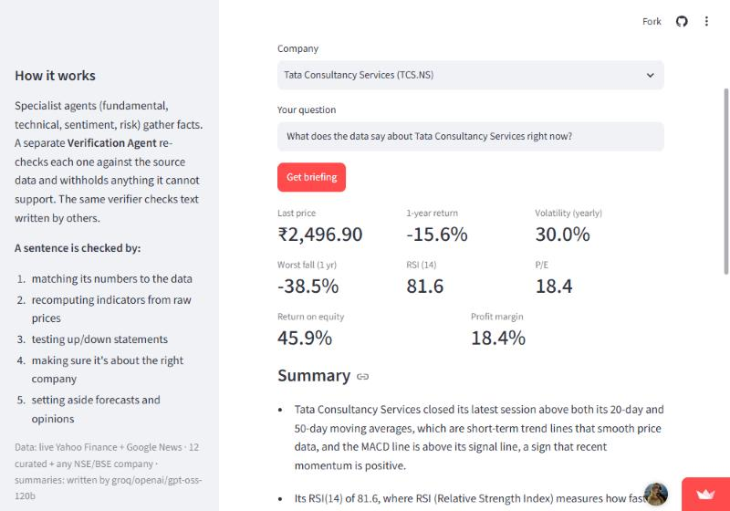
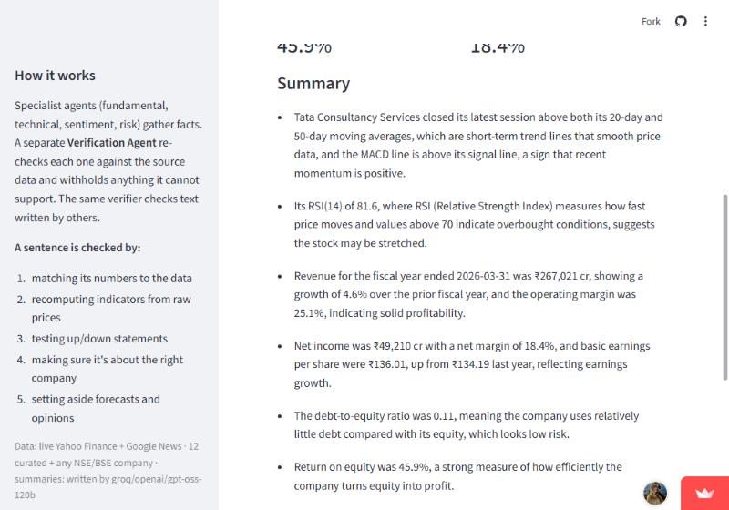
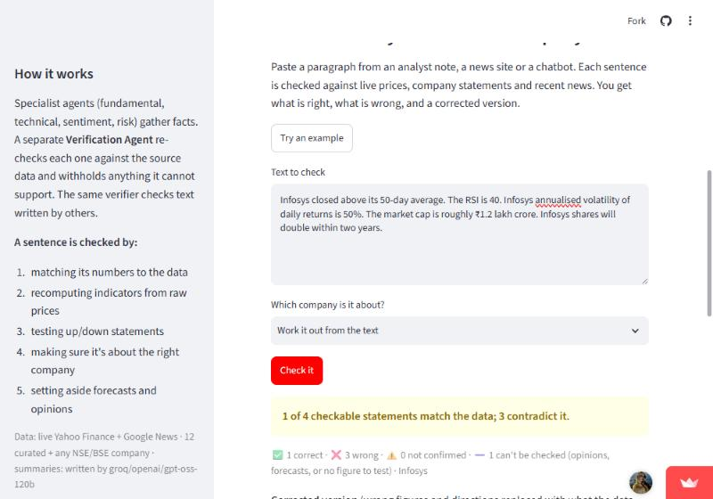
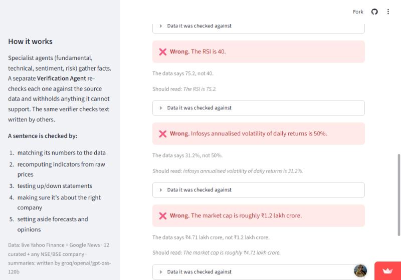
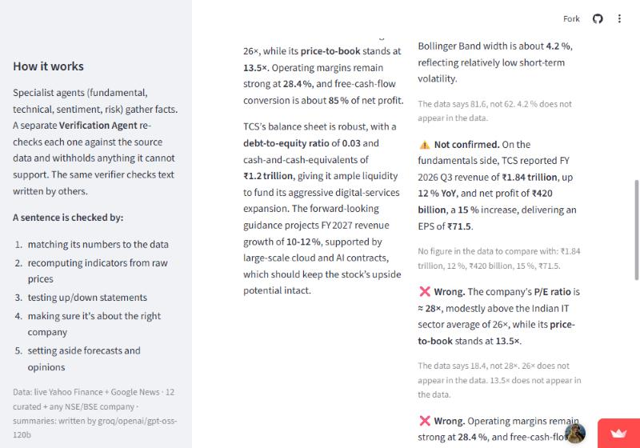
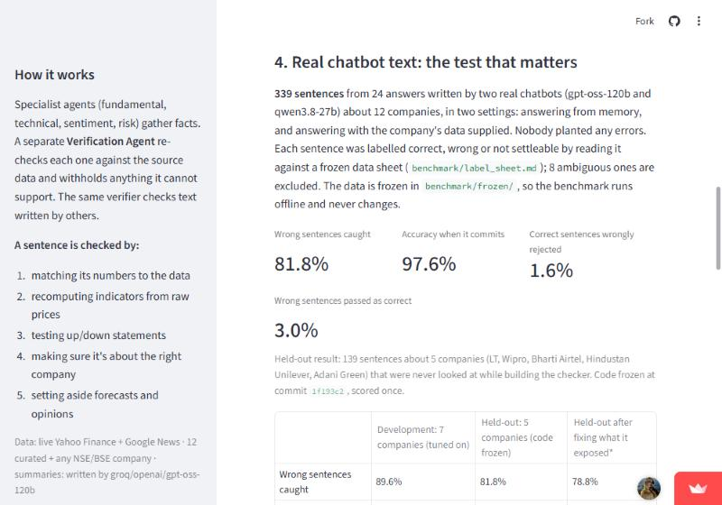
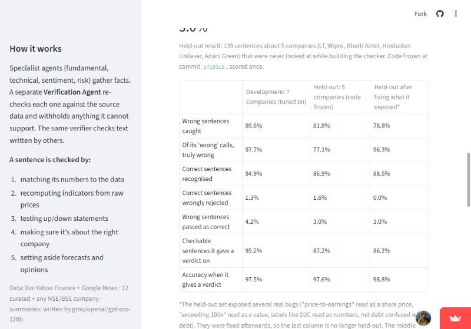

# Multi-Agent Financial Research Assistant

Specialist agents gather facts about a listed company; a separate **Verification Agent**
re-checks every claim against the source data before you see it. The same verifier can
fact-check text written by anyone else: paste what an analyst, a news site or a chatbot
wrote and see, **sentence by sentence, what the data actually supports**.

Language models write confident financial prose and get numbers and directions wrong.
This tool does not ask another model for an opinion. It re-checks each sentence against
real prices, statements and news, with deterministic rules, so every verdict has an
auditable reason:

| Verdict | Meaning |
|---|---|
| ✅ verified | every number matched the data (same value, same label) and/or the direction statement agrees with indicators recomputed from raw prices |
| ❌ contradicted | a number the data does not hold (the closest real value is shown), a direction the prices contradict, or facts attributed to the wrong company |
| ⚠️ unsupported | checkable, but nothing in the data backs it |
| ➖ not checkable | forecasts, opinions, prose with no number or indicator statement. Reported, never silently passed |

```text
"Operating margin for the year was 26.3%."   ->  ❌ 26.3% is not in the data; closest value is 24.3%
"The RSI is 91 and the stock is overbought." ->  ❌ 91 is not in the data; recomputed RSI is 23.8
"TCS shares will reach Rs. 5,000 by FY27."   ->  ➖ forecast; cannot be checked against past data
```

Under it sits a multi-agent research pipeline (router, four specialist analysts, a
Verification Agent, bounded revision) that writes cited reports whose every claim is
verified the same way. The auditor is that verifier pointed at text somebody else wrote.

Use it three ways: the Streamlit app (**Audit a text** tab), `POST /audit` on the API, or
`from agents.auditor import audit_text`.

**Live demo:** <https://multi-agent-financial-research.streamlit.app> (free hosting: it sleeps after
a while without visitors and takes about a minute to wake; the first load of a company can take
up to 30 seconds).

> Academic prototype. Not investment advice.

---

## Screenshots

Taken from the deployed app.

**Company briefing**: key figures, then a plain-English summary in which every sentence was checked
against the data first.




**Fact-check a text**: paste any paragraph; each sentence is marked correct, wrong, not confirmed or
not checkable, with the real figure and a corrected version.




**Chatbot vs the data**: a chatbot answers freely; the verifier checks every figure in its answer.



**How accurate is it?**: measured results, with the held-out set and the limits stated.




---

## What is real, what is synthetic

| Part | Data | Status |
|---|---|---|
| Verification benchmark, ablation, router, grounding | **synthetic** snapshot corpus with known ground truth (`provenance: synthetic-demo`) | needed so that "supported" has a label |
| LLM-analyst evaluation | snapshot corpus, claims written by a **local LLM** (Ollama `mistral`) | real model output, synthetic evidence |
| Live reports (default outside `--offline`) | **real** Yahoo Finance prices, annual statements (revenue, margins, EPS, ROE, leverage) and ratios, plus Google News headlines from the last 30 days; no synthetic data is mixed in | 12 curated NSE large-caps, plus any NSE/BSE company found by name (Yahoo search) |
| Sentiment-vs-returns study | **real** headlines (Google News RSS) + **real** prices (yfinance), 11 NSE equities | `eval/sentiment_study.py` |

Numbers from the synthetic corpus describe how the *mechanism* behaves on a
controlled benchmark; they are not claims about real-world accuracy.

---

## The verification mechanism

For every claim an agent produces:

1. **Independent re-retrieval** — embed the claim, retrieve top-*k* evidence
   afresh, *ignoring* the citation the agent attached.
2. **Numeric adjudication with label binding** — every quantity (%, bps, cr, ×, ₹,
   with sign and direction words: "fell 70 bps" ≡ −70 bps) must match evidence
   within relative tolerance τ = 0.5 % **and** sit beside the same words, so
   "RSI is 50" is not grounded by the "50" in "50-day moving average".
3. **Recomputation from raw data** — numbers about computed indicators (RSI, MACD,
   Bollinger, SMA, volatility, drawdown, VaR, period return) are checked against a
   fresh recomputation from the raw price series. The indexed text of those
   indicators is *not* trusted as evidence: tamper with it and a claim echoing the
   tampered value is still rejected (`tests/test_pipeline.py`).
4. **Directional checks** — numberless claims ("MACD is below its signal line",
   "price is above the 50-day average, but below the 200-day", "RSI is
   overbought", "upper band is above the price") are evaluated against the
   recomputed indicators. A contradicted statement is vetoed; a confirmed one is
   supported by the raw data itself.
5. **Semantic adjudication, citation consistency, entity binding** — as before.
6. **Bounded revision** — claims below threshold θ go back to the originating
   agent with the verifier's reason, at most *R* = 2 times, then are dropped and
   listed (with their text) under "Withheld".

The numeric term is a **veto, not a vote**.

### The "Overall view" section

Reports that use two or more specialists start with a short synthesis
(`agents/synthesis.py`): what the price action says, whether news tone and trend
agree or diverge, the volatility and worst drawdown, and (live) whether the share
price moved with or against reported revenue growth. It is deterministic — no LLM —
and built only from facts the verifier can check by itself (price vs moving
averages, RSI zone, MACD vs signal, net sentiment score, revenue growth, period
return), so every sentence is verified like any other claim. The "agree / diverge"
wording is a fixed function of those facts. It makes no recommendation.

### What the verifier cannot do

- It cannot judge **interpretation**. "Price above its average suggests a downward
  trend" has a true premise and a wrong conclusion; it is surfaced.
- It cannot judge **speculation** ("could lead to increased revenue") or
  **unsupported commentary** with no checkable quantity or direction.
- Directional checks cover the technical-indicator statements listed above, not
  arbitrary prose. Rules were extended after auditing LLM output (see below), so
  coverage is whatever has been audited — extend `_direction_conflicts` for more.
- Entity binding knows the 12 curated companies plus any company looked up in the
  current session; a claim naming a company that was never looked up is not
  entity-checked. Companies found by name get the company name and ticker stem as
  aliases only, so a headline that uses a brand name Yahoo does not list may be missed.
- Data quality varies by company: banks and insurers have no "revenue" or "operating
  margin" in Yahoo's statements, small companies have thin news. The app says so.
- Label binding needs a distinguishing word to overlap ("operating margin" will not
  match "net margin" evidence), but very different wording for the same quantity can
  be rejected: the verifier errs towards withholding.

---

## Results

Reproduce with `python -m eval.run_all --offline` (deterministic TF-IDF embedder
and lexicon scorer; `--embedder neural --scorer finbert` for the neural stack).
Every number below is in `results/`.

### 1. Perturbation benchmark (synthetic) — `results/metrics.json`

162 claims: 81 genuine agent claims, each paired with one injected defect (numeric
drift, numeric swap, entity swap, fabricated detail).

| | |
|---|---|
| Catch rate / precision / false-positive rate | 100 % / 100 % / 0 % |
| Verification cost | ≈ 5 ms per claim |

**Read this carefully.** The defects are exactly the failure types the verifier was
built to catch, injected into template claims, so this is a *consistency* check,
not evidence of real-world performance. An earlier version of this benchmark
reported 96.3 %; the three "misses" were benchmark errors (an entity swap that
attributed a company's claim to that same company). The generator now excludes
the claim's own company. The next section is the test that matters.

Ablation (same benchmark):

| Configuration | Catch rate | F1 |
|---|---|---|
| Full mechanism | 100 % | 1.00 |
| − numeric veto (additive scoring) | 48.1 % | 0.65 |
| − entity binding | 75.3 % | 0.86 |
| Semantic similarity only | 0 % | 0.00 |
| Citation trust, no re-retrieval | 0 % | 0.00 |

The same benchmark on the neural stack (`all-MiniLM-L6-v2` + FinBERT,
`results/metrics_neural.json`): 100 % catch, 0 % false positives, 100 % grounding.
Results are identical across `PYTHONHASHSEED` values (tie-breaking in retrieval is
deterministic; `tests/test_pipeline.py` guards it).

### 2. LLM-written claims — `results/llm_eval*.json`, `results/llm_claims*.csv`

LLM analysts (`agents/llm_analysts.py`) write free-form research sentences from
retrieved evidence; the same Verification Agent checks them. Nobody injected these
errors. Two models, five runs each × three companies:

| | Mistral 7B (local, Ollama) | `gpt-oss-120b` (Groq) |
|---|---|---|
| Claims | 259 | 238 |
| Withheld on first pass | 22 (8.5 %) | 1 (0.4 %) |
| – direction contradicted by raw prices | 16 (22 % of 73 technical claims) | 0 |
| – a number not in the evidence / recomputation | 4 | 1 |
| – weak semantic support | 2 | 0 |
| Wrong number per a structured oracle | 1, withheld | 0 |
| Revisions attempted → successful | 26 → 18 | 1 → 1 |

Summaries: `results/llm_eval_summary.json`, `results/groq_llm_eval_summary.json`.

Both models almost never get a *number* wrong when the evidence is in front of them.
The small model often gets a *direction* wrong ("price below the 20-day average" when
it is above); those are the errors the directional checks catch. The large model
rarely errs at all, so its run shows the verifier does not hold back correct claims,
but it says little about how well the verifier catches errors: for that you need the
perturbation benchmark and the Mistral run.

**How far to trust this.** The directional rules were developed in three rounds,
each after reading the previous round's output, so the early seeds are in-sample.
`results/llm_manual_audit.md` records every round, the leaks each one exposed, and a
final hand audit of the 57 distinct Mistral technical claims that were surfaced: none
states a checkable fact that is wrong; one is vague; two draw a wrong conclusion from
a correct premise, which the verifier cannot detect. Auditing the Groq run also
exposed two verifier bugs that wrongly rejected correct claims (ISO dates read as
numbers; "high"/"highest", "closed"/"close" not matched); both are fixed and tested.
Three tickers, synthetic evidence. Groq's model is set by `GROQ_MODEL` (Groq retires
models; the default is `openai/gpt-oss-120b`).

### 3. Sentiment vs. price moves (real data) — `results/sentiment_study.json`

FinBERT (`ProsusAI/finbert`) over **45,770 headlines** fetched from Google News RSS
for 11 NSE large-caps (TCS, Reliance, Infosys, HDFC Bank, ICICI Bank, SBI, ITC, L&T,
Wipro, Bharti Airtel, Hindustan Unilever), 17 Oct 2025 – 16 Oct 2026. **34,713**
name the company in the headline and 34,382 were scored and mapped to a trading
session. Prices: yfinance. Returns are abnormal (stock minus Nifty 50).

| Daily sentiment vs abnormal return | Pearson r | Spearman ρ | Permutation p | n (ticker-days) |
|---|---|---|---|---|
| Same day | **0.243** | 0.212 | 0.0005 | 2,465 |
| Next day | **0.045** | 0.055 | 0.026 | 2,454 |

- **Same-day** correlation is positive in all 11 stocks (r from 0.12 to 0.38;
  individually significant at 5 % in 9 of 11). Do not read it as sentiment *moving* prices: headlines on the day report the
  move ("shares fall 3 %"), and Google News gives publication dates, not times, so
  cause and effect cannot be separated.
- **Next-day** correlation is the predictive question, and it is tiny: pooled r = 0.045
  (p ≈ 0.03); only Wipro is individually significant at 5 % (r = 0.14), and 2 of 11
  stocks are negative. Eleven stocks × two horizons is a multiple-comparison setting,
  so treat this as weak at best and consistent with no effect.
- Not a trading signal: no costs, no out-of-sample split, one year of data.

Per-stock table and caveats in `results/sentiment_study.json`; the daily panel is
`results/sentiment_panel.csv`. FinBERT scores 64.6 % (macro-F1 0.64) on the
hand-labelled 48-sentence set, against 47.9 % for the offline lexicon.

### 4. Router

| | Exact match | Label recall |
|---|---|---|
| Leave-one-out on the 75 training queries | 94.7 % | 99.2 % |
| **Held-out**, 30 queries written after the router was frozen | **90.0 %** | 93.9 % |

Routing cuts agent invocations by about 60 %. The held-out figure is the honest
one; the training queries were written by the same person who designed the
features.

### 5. Real chatbot text, against hand-assigned labels — `results/real_text_benchmark*.json`

The benchmarks above plant their errors or use synthetic evidence. This one does neither.

- **Data.** 339 sentences from 24 answers written by two real chatbots
  (gpt-oss-120b, qwen3.8-27b) about the 12 curated companies, in two settings: answering from
  memory (the model is given nothing) and answering with the company's data sheet supplied.
  Nobody injected an error.
- **Frozen evidence.** The data each answer is judged against is saved in `benchmark/frozen/`
  (2026-10-27), so the benchmark is offline and the labels never go stale.
- **Labels.** Each sentence is labelled correct / wrong / partly checkable / no verdict by reading
  it against that company's data sheet (`benchmark/label_sheet.md`), under the rules in
  `benchmark/labels.py`. 8 ambiguous sentences are excluded and counted.
- **Development / test split.** The verifier was tuned only on 7 companies. Five others (LT, Wipro,
  Bharti Airtel, Hindustan Unilever, Adani Green) were scored once, with the code frozen at commit
  `1f193c2`.

| | Wrong caught | Correct recognised | Correct wrongly rejected | Wrong passed as correct | Verdict given | Accuracy when it gives one |
|---|---|---|---|---|---|---|
| Development, 7 companies (tuned on) | 89.6 % | 94.9 % | 1.3 % | 4.2 % | 95.2 % | 97.5 % |
| **Held-out, 5 companies (code frozen)** | 81.8 % | 86.9 % | 1.6 % | 3.0 % | 87.2 % | 97.6 % |
| Held-out after fixing what it exposed* | 78.8 % | 88.5 % | 0.0 % | 3.0 % | 86.2 % | 98.8 % |

\*The held-out set exposed several real bugs ("price-to-earnings" read as a share price, "exceeding
100x" read as a value, labels such as "D2C" read as numbers, net debt confused with debt, a share of
revenue compared with revenue growth). They were fixed afterwards, so that row is no longer
held-out; the held-out row is the one to quote. A verifier that trusts any sentence containing a
number catches 0.0 % of the wrong sentences and passes
98.8 % of them as correct.

What it still gets wrong, listed in the results file: sentences with a true number and a wrong
interpretation ("a high debt-to-equity ratio of 8.6 %"), which the verifier does not judge, and a
sentence calling a positive sentiment score negative. Reproduce:
`python -m eval.benchmark_real` (all), `--split dev`, `--split test`.

---

## Architecture

```
                    ┌──────────────────────┐
   user query ─────▶│  Orchestrator/Router │  trained classifier, 13 features
                    └──────────┬───────────┘
      ┌──────────┬─────────────┼─────────────┬──────────┐
      ▼          ▼             ▼             ▼          │
 Fundamental  Technical     Sentiment       Risk        │   template analysts (default)
   agent        agent        agent         agent        │   or LLM analysts (--llm)
      └──────────┴────────────┴─────────────┘           │
                       │ claims + citations             │
                       ▼                                │
          ┌────────────────────────────┐                │
          │   VERIFICATION AGENT       │  re-retrieve   │
          │ numeric · recompute ·      │◀───────────────┘
          │ direction · semantic ·     │
          │ citation · entity          │
          └─────────┬──────────────────┘
                    │ confidence < θ → bounded revision (≤ R)
                    ▼
          Report Generator — cited report, per-claim confidence, withheld claims
                         ▲
          Evidence store (ChromaDB / numpy) + raw price series
```

## Quick start

```bash
pip install -e ".[all,dev]"        # (requirements-dev.txt) or just `pip install -e .` for the small core

python pipeline.py "Should I look at TCS for a 1-year hold?" --offline   # CLI, synthetic corpus
python pipeline.py "Give me a full report on HDFC Bank"                  # CLI, live data (12 curated; the UI and API accept any NSE/BSE company)
python pipeline.py "Complete analysis of TCS" --offline --llm            # LLM analysts
streamlit run frontend/streamlit_app.py                                  # demo UI: audit a text + research report
uvicorn api.main:app --reload                                            # REST API (/audit, /research, /verify)
python -m pytest tests/ -q                                               # 136 tests, ~60 s
python -m eval.run_all --offline                                         # benchmark + ablation + router
python -m eval.llm_eval --seed 7                                         # LLM claims evaluation
python -m eval.sentiment_study all                                       # headlines -> FinBERT -> correlation
python -m eval.benchmark_real                                            # real chatbot text vs labelled sentences
```

LLM backend (for `--llm`): Groq if `GROQ_API_KEY` is set, else a local Ollama
server (`OLLAMA_MODEL` or the first installed model). Override with
`FINRESEARCH_LLM=groq|ollama|none`. Put keys in a local `.env` (copy
`.env.example`; `.env` is git-ignored).

Backends are explicit, so a number always says what produced it:
`FINRESEARCH_EMBEDDER=tfidf|neural|auto`, `FINRESEARCH_SCORER=lexicon|finbert|auto`.
Tests pin `tfidf` + `lexicon` for speed and determinism.

## Deploying

Docker image, compose file, API auth / rate limiting / background jobs, and the list of
what is still not production-grade are in [DEPLOY.md](DEPLOY.md).

## Design decisions worth defending

**The verifier never trusts the agent's citation.** It re-retrieves, and for
computed indicators it does not trust the indexed text either — it recomputes from
the raw series.

**Template analysts cannot hallucinate; LLM analysts can.** Both go through the
same verifier. The template analysts make the controlled benchmark possible; the
LLM analysts show what happens on real model output.

**Every component degrades instead of failing, and says so.** FinBERT → lexicon,
sentence-transformers → TF-IDF+SVD, ChromaDB → numpy, Groq → Ollama → templates.
The fallback is logged and the chosen backend is recorded in `metrics.json`.

**Live mode never mixes real prices with invented filings.** Live fundamentals come
from Yahoo Finance; the synthetic filings exist only in the snapshot corpus.

## Repository layout

```
core.py                 Claim / Chunk / Verdict / Report, numeric extraction
pipeline.py             end-to-end orchestration (CLI)
llm.py                  Groq / Ollama backends
config.py               loads .env;  logging_setup.py  logging
agents/
  orchestrator.py       query router (feature-based classifier)
  data_collector.py     indicators, derived evidence
  analysts.py           template analysts
  llm_analysts.py       LLM analysts (claims written by a model)
  synthesis.py          "Overall view": agree / diverge across the specialists
  validator.py          ★ the verification mechanism
  auditor.py            audits pasted text sentence by sentence (uses the validator)
  report_generator.py   cited report, confidence badges, withheld claims
api/                    FastAPI service (auth, rate limit, background jobs)
rag/                    embedder (pluggable) + evidence store
data/
  universe.py           the curated 12 + run-time registry for any NSE/BSE company (single source of truth)
  corpus.py             snapshot corpus; live evidence (prices, statements, news)
  connectors/           yfinance, Google News, GDELT, RSS
benchmark/              frozen company data, collected chatbot answers, gold labels
eval/                   perturbation benchmark, ablation, LLM eval, sentiment study, router test set
results/                every reported number
tests/                  136 tests, ~80 % line coverage
```

## Known limitations

- Benchmark evidence is synthetic; the LLM evaluation uses one 7B local model, three
  tickers and a handful of sampling seeds.
- Verification of qualitative claims is limited to the directional rules above.
- Sentiment study: one year, eleven stocks, headlines only, publication dates only.
- Live news from plain RSS is sparse; the live sentiment agent reports nothing when
  no headlines match.

---

*Research output from an academic prototype. Not investment advice.*


